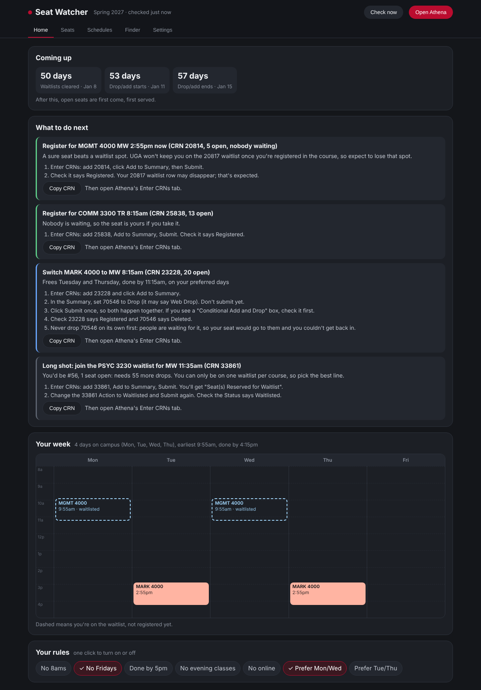
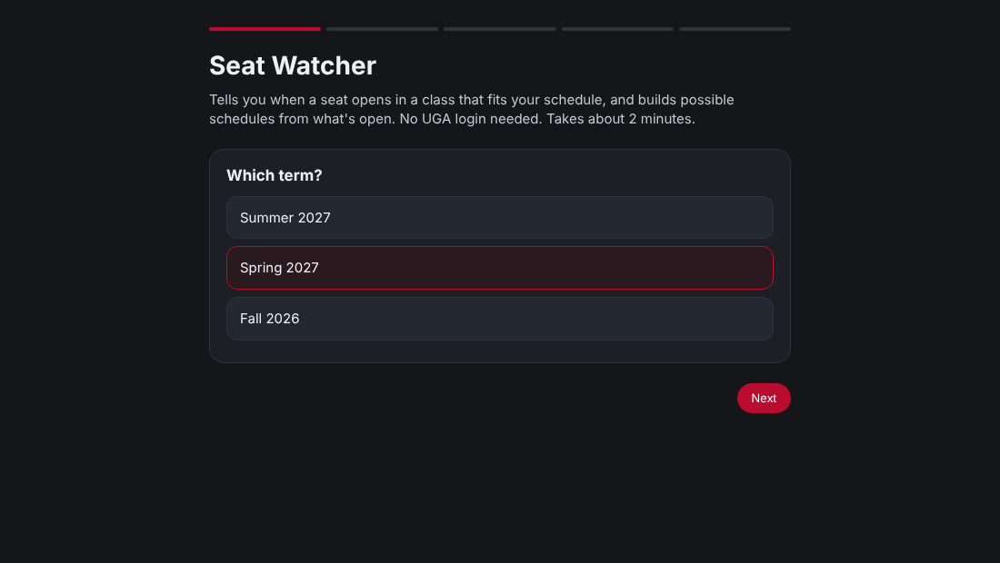
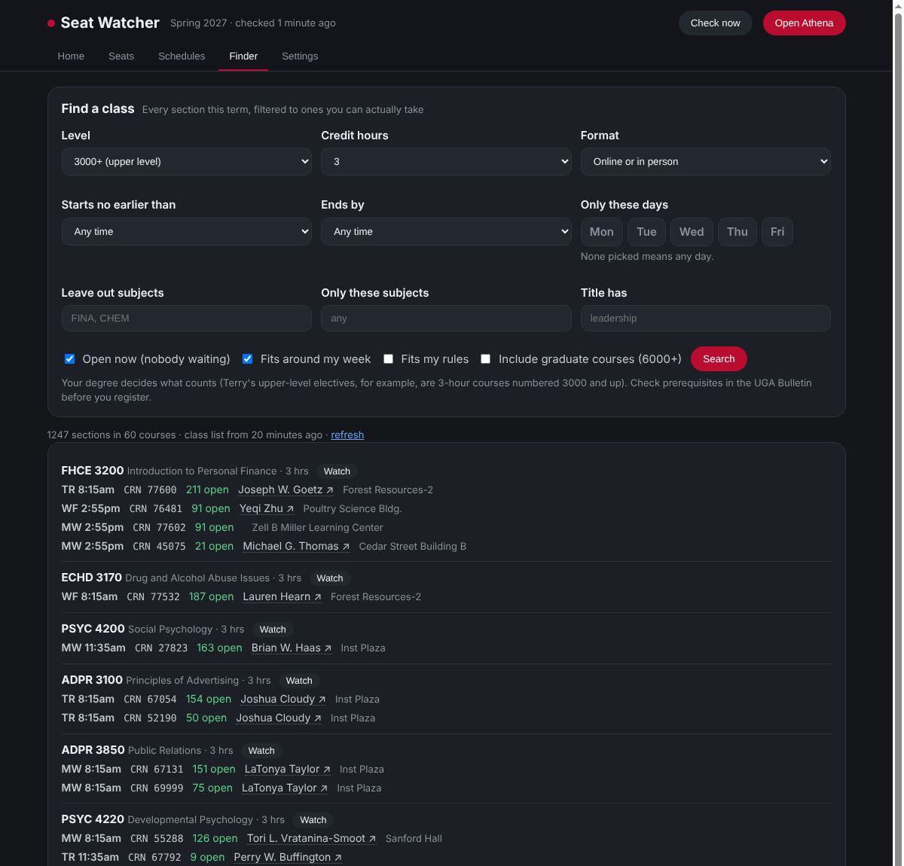
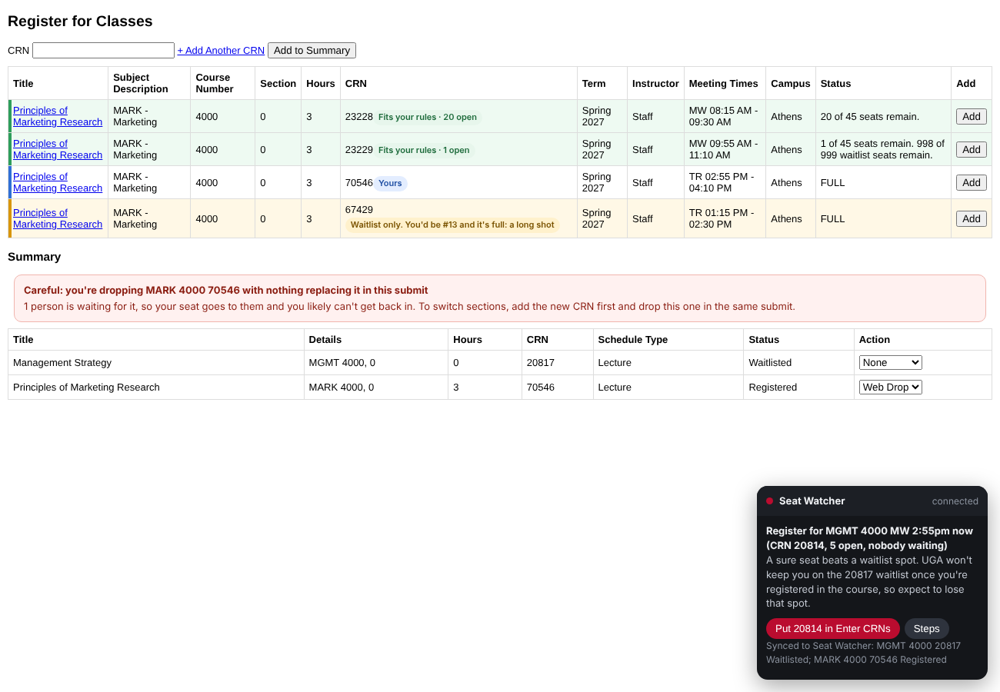

# UGA Seat Watcher

Tells you what to do next in UGA registration: when a seat opens in a class that fits your week,
which waitlist you'd actually get off of, and how to switch sections without losing your seat.
Builds possible weekly schedules from what's open, and finds open electives. Runs on your own
laptop, Windows or Mac.

- **No UGA login, no Duo.** It reads Athena's public "Browse Classes" search, the same one anyone
  can use without signing in.
- **Your week and your next move.** Mark the section you're in (or waitlisted for) and Home shows
  your week and exactly what to do, step by step in Athena's words: register now, switch sections
  in one submit, move your waitlist spot, or hold.
- **Waitlist odds.** "You'd be #17 for 17 seats: likely" vs "#55 for 1 seat: a long shot". You can
  only be on one waitlist per course, so it helps you pick the line.
- **Never lose a seat by accident.** It never tells you to drop first, and the Chrome extension
  warns you in Athena if you're about to drop a class with people waiting for your seat.
- **Only real seats count.** While anyone is on a section's waitlist, Athena holds every open seat
  for them, so a section only counts as open when nobody is waiting.
- **Your rules, one click each.** No 8ams, No Fridays, Done by 5pm, Prefer Mon/Wed and more. None
  are on until you pick them, and one click turns each off again.
- **Backups.** A seat you don't love beats no seat. If everything that fits is full, it tells you
  which sections still have room.
- **Switch mode.** Already registered? Star the sections you'd rather have and it only alerts for
  those.
- **Schedules.** Every combination of open sections with no time clashes, ranked by fewest days on
  campus, no early mornings, no late classes and no long gaps. One click copies the CRNs.
- **Alerts** on your desktop, and on your phone through the free ntfy app or Discord.
- **Finder.** Search every section this term for an open class that fits around your week: level,
  online or in person, days, times, subjects to leave out. Good for electives.
- **Seat history.** When a full section reopens, it shows when.
- **Key dates.** A countdown to waitlists clearing and drop/add.
- **Tight walks.** Flags back-to-back classes on opposite sides of campus.
- **Rate My Professors** link on every instructor's name.
- **Chrome extension and Claude.** Optional: color Athena's own pages, and ask Claude about your
  schedule. See below.

It never registers you for anything. It tells you, and you register in Athena yourself.

## Setup (about 3 minutes)

1. **Install Node.js** (free) from https://nodejs.org. Pick the LTS version. Skip this if you
   already have it.
2. **Download this project.** On this page click the green **Code** button, then **Download ZIP**,
   and unzip it.
   - GitHub's zip has a folder inside a folder (`uga-seat-watcher-main\uga-seat-watcher-main`).
     Use the inner one, the one with `Start Here` files in it.
   - **Mac:** move the folder into your home folder, not Desktop, Documents or Downloads. macOS
     blocks background apps from reading those, so it would quietly stop after a restart.
3. **Double-click the launcher:**
   - **Windows:** `Start Here (Windows).cmd`. If Windows warns you, click "More info" then
     "Run anyway".
   - **Mac:** right-click `Start Here (Mac).command`, choose Open, then Open again.
4. **Setup opens in your browser.** Pick the term, add your courses (by course code, like
   BUSN 4000, straight off your advising sheet), pick any rules you care about, and turn on phone
   alerts if you want them. Leave "run in the background" checked.
5. **Tell it what you have.** On the Seats tab, tap **I'm in this** on each section you're
   registered in, or **Waitlisted** on the one you're waiting for. (The Chrome extension can do this
   for you from Athena.) Now Home can plan around your real week.

That's it. The dashboard lives at **http://127.0.0.1:4830**. Bookmark it, or double-click the
launcher again any time to open it. On Windows it's also in the Start menu as "Seat Watcher".

## Using it

- **Home:** your week (dashed means waitlisted), what to do next with the exact Athena steps, key
  dates, and your rules as one-click chips.
- **Seats:** every section of your courses. Bright means you can register now, faded means full. A
  green edge means it fits your rules; an amber edge says why it doesn't ("meets Fri", "starts
  8:15am"). Each section shows your waitlist odds and, if it was full and reopened, when. Mark your
  own sections here. Star (☆) a section to switch that course to "only tell me about these". Turn a
  course's alerts off when you're happy with it; it keeps checking so your week stays current.
- **Schedules:** possible weeks built from open seats plus the sections you hold, with how many
  changes each one takes from your week.
- **Finder:** any open class that fits around your week. Your degree decides what counts, and you
  should check prerequisites in the UGA Bulletin before registering.
- **Settings:** change anything from setup. To start setup over, delete `config.json` and run the
  launcher again.

**Switching sections, the safe way:** add the new CRN and drop the old one in the same submit. If
the old section has people waiting and you drop it first, your seat goes to them and you can't get
back in. Seat Watcher's steps always do it the safe way.

## Chrome extension (optional)

Works on Athena's Register for Classes page while Seat Watcher runs: colors search results (fits,
waitlist only with your odds, full, yours), syncs your Registered and Waitlisted classes into Seat
Watcher, warns before a risky drop, and can put your next CRN in the Enter CRNs box. It never
clicks Submit and never sees your password.

*Shown on a test copy of Athena's page, which is why Athena's own styling is missing.*

Install: in Chrome go to `chrome://extensions`, turn on **Developer mode**, click **Load unpacked**,
and pick the `extension` folder. Details in [extension/README.md](extension/README.md).

## Ask Claude about your schedule (optional)

`mcp.mjs` connects Seat Watcher to Claude through MCP (the connector format Claude uses for tools),
so you can ask things like "what should I do about RMIN?" or "find me an open online upper-level
class that fits my week". It talks to the Seat Watcher running on your computer and never registers
anything.

- **Claude Code:** `claude mcp add uga-seat-watcher -- node "/full/path/to/uga-seat-watcher/mcp.mjs"`
- **Claude Desktop:** Settings > Developer > Edit Config, and add inside `"mcpServers"`:
  `"uga-seat-watcher": { "command": "node", "args": ["/full/path/to/uga-seat-watcher/mcp.mjs"] }`,
  then restart Claude Desktop. On Windows, write the path with double backslashes
  (`C:\\Users\\you\\uga-seat-watcher\\mcp.mjs`).

## Phone alerts

Setup can make you an **ntfy** topic. ntfy is a free notification app: install it from the App
Store or Google Play, tap +, and subscribe to that exact topic. Treat the topic like a password,
since anyone who knows it can see your alerts.

For Discord, make a webhook in a channel (Server Settings > Integrations > Webhooks) and paste the
link into Settings. Same deal: keep the link private.

## When it runs

It checks every 3 minutes while your computer is on and you're logged in. Sleep or a closed lid
pauses it, and it picks back up when the computer wakes. After a restart it starts by itself as
soon as you log in.

- Windows: a Task Scheduler task called "UGA Seat Watcher" (your user only, no admin needed).
- Mac: a launch agent at `~/Library/LaunchAgents/com.ugaseatwatcher.agent.plist`.

Seats open all through registration as people drop and swap. The big window is right before
drop/add: UGA closes waitlists 3 days before drop/add starts, and after that an open seat goes to
whoever grabs it first. Keep your computer awake that week.

## Make it yours with Claude

Want a different alert, a new rule like "no back to back classes", or a different way of ranking
schedules? Open this folder in Claude Code (or any coding agent) and ask. [CLAUDE.md](CLAUDE.md)
explains how everything fits together and the mistakes not to repeat, so the agent starts out
knowing the project. `AGENTS.md` points other agents to the same file.

## Troubleshooting

| Problem | Fix |
|---|---|
| `node` is not recognized | Install Node.js, then close and reopen the launcher. |
| `Cannot find module ...watcher.mjs` | You're in the outer folder of GitHub's zip. Open the inner `uga-seat-watcher-main` folder. |
| The launcher opens someone else's page, or says another copy is running | Another copy is already using port 4830. The message says which folder; run `node watcher.mjs --uninstall` there first. |
| No desktop alerts on Mac | System Settings > Notifications > Script Editor > Allow. |
| Stops working after a Mac restart | The folder is in Desktop, Documents or Downloads. Move it to your home folder and run the launcher again. |
| Says a section is full but Athena shows seats | Someone is on the waitlist, so Athena holds every open seat for the waitlist. Join it, or wait for it to clear. |
| Home says "Mark the sections you have" | Tap **I'm in this** or **Waitlisted** on the Seats tab, or open your Summary in Athena with the extension installed. |
| The extension panel says "not running" | Start Seat Watcher with the launcher. If you changed its port, set the same port in the extension's popup. |
| Finder says it's downloading | The first search of the day pulls the whole term from Athena, slowly on purpose. Give it about a minute. |
| Nothing at all | Check the log: `%LOCALAPPDATA%\uga-seat-watcher\watcher.log` on Windows, `~/Library/Application Support/uga-seat-watcher/watcher.log` on Mac. |

## Commands

Run these from the project folder.

| Command | What it does |
|---|---|
| `node watcher.mjs --open` | Start it and open the dashboard (what the launcher does) |
| `node watcher.mjs --once` | One check, printed, no alerts |
| `node watcher.mjs find BUSN 4000` | Every section of a course |
| `node watcher.mjs --test` | Send a test alert |
| `node watcher.mjs --install` | Start automatically at login |
| `node watcher.mjs --uninstall` | Stop starting at login, and stop it now |
| `node mcp.mjs` | The MCP server for Claude (Claude starts this for you) |
| `npm test` | Offline tests: rules, schedules, advice, finder |

## Be nice to Athena

One search per course every few minutes is nothing. Please don't set it below 2 minutes, and don't
run several copies. The Finder downloads the whole term at most once every 6 hours, only when you
use it. If a lot of people hammer Athena, UGA will block it for everyone.

## Other schools

Athena runs on Ellucian Banner 9, which many universities use. Changing `school.athena` and
`school.register_url` in `config.json` should work for other Banner schools, but that's untested.
Try `node watcher.mjs find SUBJ 1234` first.

## License

MIT. Use it, change it, share it. Not affiliated with UGA.
