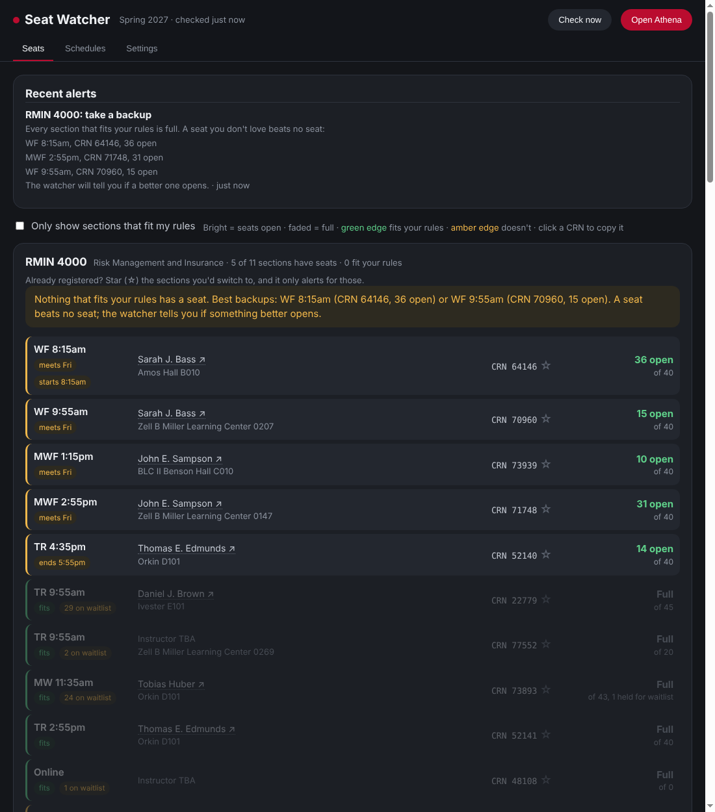
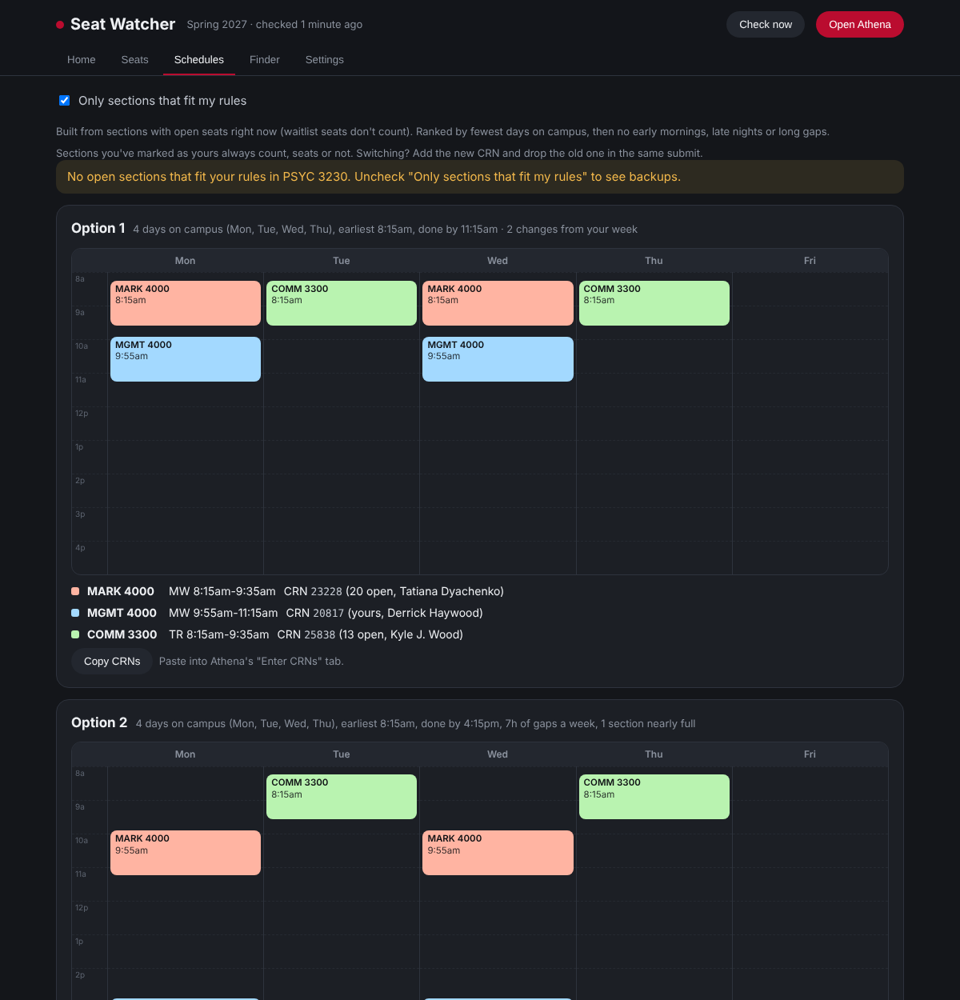

# UGA Seat Watcher

Tells you when a seat opens in a UGA class that fits your schedule, and builds possible weekly
schedules out of what's open right now. Runs on your own laptop, Windows or Mac.

- **No UGA login, no Duo.** It reads Athena's public "Browse Classes" search, the same one anyone
  can use without signing in.
- **Only real seats count.** Athena gives an open seat to the waitlist first, so a seat only counts
  as open when more seats are open than people waiting.
- **Your rules.** Earliest start, latest end, days to skip, days you prefer, online or not.
- **Backups.** A seat you don't love beats no seat. If everything that fits is full, it tells you
  which sections still have room.
- **Switch mode.** Already registered? Star the sections you'd rather have and it only alerts for
  those.
- **Schedules.** Every combination of open sections with no time clashes, ranked by fewest days on
  campus, no early mornings, no late classes and no long gaps. One click copies the CRNs.
- **Alerts** on your desktop, and on your phone through the free ntfy app or Discord.
- **Rate My Professors** link on every instructor's name.

It never registers you for anything. It tells you, and you register in Athena yourself.

## Setup (about 3 minutes)

1. **Install Node.js** (free) from https://nodejs.org. Pick the LTS version. Skip this if you
   already have it.
2. **Download this project.** On this page click the green **Code** button, then **Download ZIP**,
   and unzip it.
   - GitHub's zip has a folder inside a folder (`uga-seat-watcher-main\uga-seat-watcher-main`).
     Use the inner one, the one with `Start Here` files in it.
   - **Mac:** move the folder into your home folder, not Desktop, Documents or Downloads. macOS
     blocks background apps from reading those, so it would quietly stop after a restart.
3. **Double-click the launcher:**
   - **Windows:** `Start Here (Windows).cmd`. If Windows warns you, click "More info" then
     "Run anyway".
   - **Mac:** right-click `Start Here (Mac).command`, choose Open, then Open again.
4. **Setup opens in your browser.** Pick the term, add your courses, set your rules and turn on
   phone alerts if you want them. Leave "run in the background" checked.

That's it. The dashboard lives at **http://127.0.0.1:4830**. Bookmark it, or double-click the
launcher again any time to open it. On Windows it's also in the Start menu as "Seat Watcher".

## Using it

- **Seats:** every section of your courses. Bright means seats are open, faded means full. A green
  edge means it fits your rules; an amber edge says why it doesn't ("meets Fri", "starts 8:15am").
  Click a CRN to copy it, click an instructor for Rate My Professors, and star (☆) a section to
  switch that course to "only tell me about these."
- **Schedules:** possible weeks built from open seats. Uncheck "only sections that fit my rules" to
  see weeks that use backups.
- **Settings:** change anything from setup. Saved changes apply right away. To start setup over,
  delete `config.json` and run the launcher again.

## Phone alerts

Setup can make you an **ntfy** topic. ntfy is a free notification app: install it from the App
Store or Google Play, tap +, and subscribe to that exact topic. Treat the topic like a password,
since anyone who knows it can see your alerts.

For Discord, make a webhook in a channel (Server Settings > Integrations > Webhooks) and paste the
link into Settings. Same deal: keep the link private.

## When it runs

It checks every 3 minutes while your computer is on and you're logged in. Sleep or a closed lid
pauses it, and it picks back up when the computer wakes. After a restart it starts by itself as
soon as you log in.

- Windows: a Task Scheduler task called "UGA Seat Watcher" (your user only, no admin needed).
- Mac: a launch agent at `~/Library/LaunchAgents/com.ugaseatwatcher.agent.plist`.

Seats open all through registration as people drop and swap. The big window is right before
drop/add: UGA closes waitlists 3 days before drop/add starts, and after that an open seat goes to
whoever grabs it first. Keep your computer awake that week.

## Make it yours with Claude

Want a different alert, a new rule like "no back to back classes", or a different way of ranking
schedules? Open this folder in Claude Code (or any coding agent) and ask. [CLAUDE.md](CLAUDE.md)
explains how everything fits together and the mistakes not to repeat, so the agent starts out
knowing the project. `AGENTS.md` points other agents to the same file.

## Troubleshooting

| Problem | Fix |
|---|---|
| `node` is not recognized | Install Node.js, then close and reopen the launcher. |
| `Cannot find module ...watcher.mjs` | You're in the outer folder of GitHub's zip. Open the inner `uga-seat-watcher-main` folder. |
| The launcher opens someone else's page, or says another copy is running | Another copy is already using port 4830. The message says which folder; run `node watcher.mjs --uninstall` there first. |
| No desktop alerts on Mac | System Settings > Notifications > Script Editor > Allow. |
| Stops working after a Mac restart | The folder is in Desktop, Documents or Downloads. Move it to your home folder and run the launcher again. |
| Says a section is full but Athena shows a seat | Someone is on the waitlist, and that seat is theirs. |
| Nothing at all | Check the log: `%LOCALAPPDATA%\uga-seat-watcher\watcher.log` on Windows, `~/Library/Application Support/uga-seat-watcher/watcher.log` on Mac. |

## Commands

Run these from the project folder.

| Command | What it does |
|---|---|
| `node watcher.mjs --open` | Start it and open the dashboard (what the launcher does) |
| `node watcher.mjs --once` | One check, printed, no alerts |
| `node watcher.mjs find BUSN 4000` | Every section of a course |
| `node watcher.mjs --test` | Send a test alert |
| `node watcher.mjs --install` | Start automatically at login |
| `node watcher.mjs --uninstall` | Stop starting at login, and stop it now |
| `npm test` | Offline tests for the rules and schedule builder |

## Be nice to Athena

One search per course every few minutes is nothing. Please don't set it below 2 minutes, and don't
run several copies. If a lot of people hammer Athena, UGA will block it for everyone.

## Other schools

Athena runs on Ellucian Banner 9, which many universities use. Changing `school.athena` and
`school.register_url` in `config.json` should work for other Banner schools, but that's untested.
Try `node watcher.mjs find SUBJ 1234` first.

## License

MIT. Use it, change it, share it. Not affiliated with UGA.
